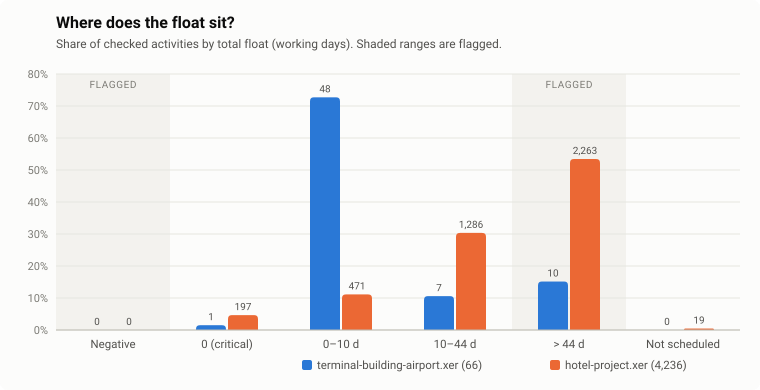

# xercheck

A small checker for Primavera P6 `.xer` schedule exports. It reads the file,
sets aside broken rows (with the line number and the reason), runs three
schedule checks and draws one chart.

```
python -m xercheck data/terminal-building-airport.xer data/hotel-project.xer
```

Pure Python 3.10+, standard library only. Nothing to install, and it checks
both files (4,300 activities, 7,670 links) in about 0.2 s.



## What it found

| | Terminal building (airport) | Hotel project |
|---|---:|---:|
| P6 version, encoding | 5.0, Windows-1252 | 6.0, Windows-1252 |
| Activities / links | 66 / 84 | 4,236 / 7,586 |
| Broken rows set aside | 0 | 0 (19 warnings) |
| **Missing links** (no predecessor / no successor) | 0 / 0 | 20 / 25 |
| Dangling ends (warning) | 11 | 207 |
| **Negative float** | 0 | 0 |
| **High float** (> 44 working days) | 10 (15%) | 2,263 (53%) |
| High float that also has a logic gap | 4 of 10 | 115 of 2,263 |

What stands out:

- **Hotel: half the schedule has more than two months of float.** 2,263 of
  4,236 checked activities. In a construction programme that rarely means real
  slack; it usually means logic that stops short, so the network doesn't hold
  those activities back.
- **Hotel: the `CR` project is not a schedule yet.** All 19 activities have no
  predecessor, no successor and no float. P6 never scheduled them. They account
  for 19 of the 20 and 19 of the 25 missing links.
- **Terminal: the logic is complete but leaks at the finish.** Every activity
  has a predecessor and a successor, yet 11 have only start-to-start
  successors, so their finish drives nothing. 4 of the 10 high-float
  activities are among them. That points to where the float comes from.
- **No negative float in either file.** Both are unstarted baselines (every
  activity is `TK_NotStart`), and negative float usually appears once progress
  slips against a deadline. The check is proven on the test fixture instead.

The full lists are in [`reports/`](reports): `report.html` (open it in a
browser), one `findings.csv` and one `row-issues.csv` per file, and
`summary.json`.

## The checks

All three skip finished activities and summary activities (level of effort,
WBS summary), the same scope DCMA's 14-point assessment uses.

| Check | Flags | Severity |
|---|---|---|
| Missing links | no predecessor (start milestones exempt) or no successor (finish milestones exempt) | error |
| | *dangling start*: only FF/SF predecessors, nothing drives the start | warning |
| | *dangling finish*: only SS/SF successors, the finish drives nothing | warning |
| Negative float | total float < 0 | error |
| High float | total float > 44 working days (DCMA limit; `--high-float-days` to change) | warning |

Float is stored in hours in the XER. It is turned into working days with the
hours-per-day of **each activity's own calendar**, not a flat 8 hours.

## Broken rows

The reader never stops on a bad line. Rows it can't trust are set aside and
listed with the line number, and the checks run on what is left:

- **Structure:** wrong number of columns, `%R` before `%F`, a line that isn't
  `%T/%F/%R/%E`, data after `%E`, no `%E` (file cut off).
- **Activities:** missing or duplicate `task_id`, total float that isn't a
  number. An activity with no float at all is kept with a warning ("not
  scheduled").
- **Links:** pointing at an activity that isn't in `TASK`, an activity linked
  to itself, the same link twice.
- **Encoding:** P6 writes in the Windows code page, not UTF-8. Both real files
  are Windows-1252; the reader tries UTF-8, then cp1252, then latin-1.

The two real files are clean, so `tests/fixtures/planted-defects.xer` holds one
of each problem. Run the checker on it to see them all:

```
python -m xercheck tests/fixtures/planted-defects.xer --out /tmp/demo
```

## Run it

```
python -m xercheck data/*.xer                    # report in ./reports
python -m xercheck my.xer --high-float-days 30   # stricter threshold
python -m unittest -v                            # 24 tests
pip install -e . && xercheck data/*.xer          # optional console command
```

## Layout

```
xercheck/parser.py    reads %T/%F/%R, encoding, structural broken rows
xercheck/schedule.py  activities, links, calendars; field-level broken rows
xercheck/checks.py    the three checks
xercheck/chart.py     float chart, hand-written SVG
xercheck/report.py    console, CSV, JSON and HTML output
tests/                parser, checks, both real files (pinned counts), CLI
```

## What I'd add next

- Lag checks and hard constraints, the next DCMA points after logic and float.
- Open ends per project rather than per file, for multi-project exports.
- Compare two updates of the same schedule: what changed, and what lost float.

## Data

Both `.xer` files are real P6 exports from the
[CodeVision3000/P6-Viewer](https://github.com/CodeVision3000/P6-Viewer) sample
set (MIT, see [`data/LICENSE-P6-Viewer.txt`](data/LICENSE-P6-Viewer.txt)),
renamed only.
